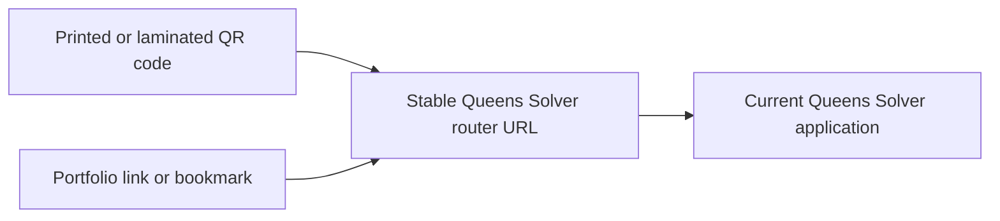

# Queens Solver — QR Code Router

This repository provides a stable web address for **Queens Solver**, Joey Wilkes's Queens puzzle solver. Visitors follow a portfolio link or scan a QR code, open the router, and are forwarded to the current application.

The router lets you **print, laminate, and distribute a QR code, then maintain its destination in one place.** If Queens Solver moves to a different URL or hosting provider, update the router while keeping the address encoded in the QR code unchanged.

## Why use a router?

A stable entry point keeps shared links and physical materials useful as the application evolves:

- **Preserve printed materials.** QR codes that point to the router can continue working after a destination change, without reprinting or redistributing them.
- **Centralize updates.** One destination change updates every portfolio link, bookmark, and QR code that uses the router address.
- **Support future moves.** The application can be hosted independently while visitors retain a consistent way to reach it.

These benefits depend on preserving the router URL and keeping its GitHub Pages publication available.

## Routing



| Address | URL |
| --- | --- |
| **Share or encode in the QR code** | [https://joeywilkes12.github.io/queens-solver-router/](https://joeywilkes12.github.io/queens-solver-router/) |
| Current application destination | [https://queens-solver.replit.app/](https://queens-solver.replit.app/) |

Download the existing QR assets as [PNG](queens-solver-router-qr.png) or [SVG](queens-solver-router-qr.svg). Both encode the stable router address. Preserve the white border around the code when printing or placing it.

## Implementation

The router is a static HTML page rendered by GitHub Pages with Jekyll. A single `redirect_url` setting in [index.html](index.html) supplies the destination for:

- A **meta refresh** that forwards the browser automatically.
- **JavaScript** using `window.location.replace(...)`, so the router does not add an entry to browser history.
- A **manual link** for visitors whose browser blocks automatic navigation.
- The canonical link and structured metadata.

The redirect happens in the browser; the router page itself returns HTTP 200 rather than an HTTP 301/302 redirect. No application backend or database is required for the router.

## Deployment

GitHub Pages publishes this repository with the following configuration:

| Setting | Value |
| --- | --- |
| Publishing branch | `main` |
| Publishing folder | `/` (repository root) |
| Rendering | GitHub Pages' built-in Jekyll build |
| Live router file | [index.html on main](https://github.com/JoeyWilkes12/queens-solver-router/blob/main/index.html) |

Keep `.nojekyll` absent: Jekyll processes the Liquid expressions that insert the destination URL. Opening the source HTML directly skips that processing; use a rendered preview when checking changes.

## Changing the destination

1. Confirm the replacement application is published and accessible at its new HTTPS URL.
2. Create a feature branch from `main` and update `redirect_url` at the top of `index.html`. Keep it an absolute HTTPS URL in double quotes:

   ```yaml
   redirect_url: "https://queens-solver.replit.app/"
   ```

3. Validate a rendered preview using the link checker and browser checks described in [MAINTENANCE.md](MAINTENANCE.md), and update the current destination in this README.
4. Open a pull request against `main` for review. Merge only after the repository owner's explicit approval; merging starts GitHub Pages publication.
5. After publication finishes, verify that the router URL and a scanned QR code both reach the new destination.

Keep the repository name, public router URL, and existing QR assets unchanged when moving the application. See the [maintenance guide](MAINTENANCE.md) for preview setup, validation commands, publication checks, and rollback instructions.
